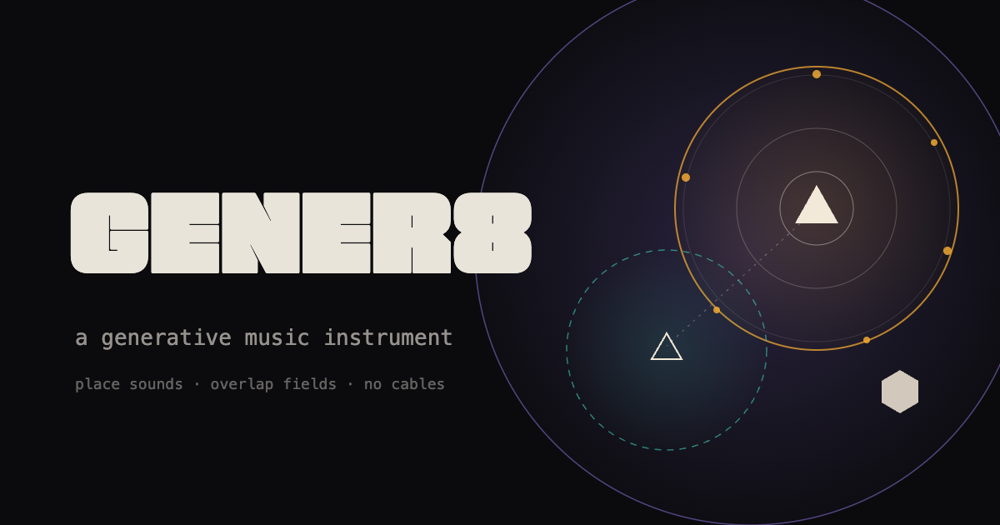
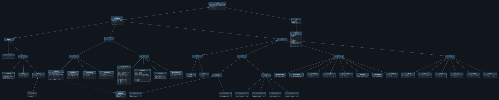

<p align="center"></p>

# GENER8

A generative music instrument on an infinite canvas. You place **sounds**, overlap them with **fields**, and let proximity, motion and ripples do the rest. There are no cables, tracks or patterns. Where things sit *is* the patch.

It runs in the browser on custom DSP (no samples, no native Web Audio nodes), and every render is **bit-identical from a single seed**.

## Quick start

```sh
npm install
npm run dev        # open the printed URL, press space
```

Press **space** to start audio. The ambient demo loads first. **examples ▾** in the bottom bar has eight more: tape, loops (airport-style phasing), rainfall, bloom, choir (motion only), cells (automaton), rhythmic and a stress patch.

**On a phone or tablet** the layout adapts: tap ▶ to start, **+** opens the palette, pinch to zoom, drag empty space to pan, tap a selected object again to step down through what's under it, and double-tap a sound for its internals.

## How it works

**Sounds** are synth voices. **Fields** are regions that affect any sound inside them. How deep a sound sits in a field sets how strongly that field acts on it, and overlap and proximity are the only relationships.

| Colour | Role | What it does |
|---|---|---|
| warm white | **sound** | Makes the audio. Filled sounds are driven by a generator; hollow ones listen for ripples. |
| amber | **generator** | Triggers notes on the sounds inside it. |
| teal | **transformer** | Changes those notes (thins, transposes, harmonises, stretches…). |
| violet | **fx** | Processes the audio (filter, tape, delay, chorus, reverb, shimmer). |

**The canvas has fixed meanings:**
- Height is pitch (up is higher, snapped to the key).
- Left/right is stereo position.
- A sound's size is its loudness and how far its ripples reach.

**Processing order** is fixed by role: generators → transformers → sound → fx. Within a role, the layer order (`[` `]`) decides.

**Motion is modulation.** Any object can breathe, orbit, drift or follow a path, so a sound sliding through a filter field gets a sweep and a breathing field changes intensity. There is no separate modulation matrix.

**Ripples:** every note sends out a ring that expands at a tempo-synced speed. Hollow sounds it reaches answer, delayed by distance, so layout alone gives you call-and-response. Chain depth and per-sound refractory periods keep feedback in check.

## Elements

| | |
|---|---|
| **Sounds** | subtractive · fm · pluck · percussion · pad · drone · additive · noise |
| **Generators** | pulse (Euclidean) · drift (random walk) · arp · rain · strum · grid (cellular automaton) |
| **Transformers** | probability · transpose · quantise · harmony · humanise · hold · ratchet · every Nth |
| **FX** | filter · tape · tape delay · chorus · reverb · shimmer |

## Controls

| | |
|---|---|
| space | start / pause audio |
| drag from palette | place a sound or field |
| drag object | move it (alt-drag duplicates) |
| handles | ▪ size · ◔ character (drag up/down) |
| select anything | the motion bar appears: breathe / orbit / drift / path, with drag-or-scroll values |
| tab / shift-tab | cycle through everything under the cursor, including field edges |
| double-click or zoom into a sound | open its internals (oscillators, filter, ADSR) |
| pinch / ⌘-scroll | zoom · two-finger / right-drag / space-drag: pan |
| ↑ ↓ ← → | nudge a semitone (shift: an octave) |
| `[` `]` | layer down / up |
| timeline strip | drag to preview the last 5 minutes, release to branch from there |
| c / ● capture | save the last 30 s as WAV, plus the patch, seed and edit log |
| vol | master level (drag or scroll) |
| mixer | per-sound level, mute and solo, FX returns, master, with live meters. Double-click a fader to reset it. |
| bottom bar | new · open · save · examples |
| h / ? | help |

Mixer levels, mutes and solos are stored in the patch, so they're part of every capture and replay.

## Determinism

The DSP is plain TypeScript in `src/core/`, shared unchanged by the AudioWorklet and Node. It avoids `Math.sin/exp/pow/…` (not bit-identical across JS engines) in favour of its own implementations, and all randomness is counter-based on the seed. As a result:
- A patch renders bit-identically every time, at any buffer size.
- A capture's JSON (root patch + edit log) re-renders its WAV bit for bit: `npm run render-capture capture.json capture.wav`.

## Scripts

| | |
|---|---|
| `npm run dev` / `build` / `preview` | Vite |
| `npm test` | determinism, golden hashes, every registered type, ripples, stress |
| `npm run stress` | renders 24 sounds × 12 fields for 60 s and reports speed against real time |
| `npm run render patch.json 60 out.wav` | offline render |
| `npm run golden` | regenerate reference hashes after an intended sound change |

Tests run on Node's built-in runner with native TypeScript (Node ≥ 22.18). The only dependencies are dev ones: Vite, TypeScript and `@types/node`.

## Adding a sound or field type

Each type is one file plus one line in `src/core/sounds/registry.ts` or `src/core/fields/registry.ts`, with no changes to core code. `test/registry.test.ts` picks up new types automatically: each must render finite, audible, non-clipping audio, and each field must audibly change the sound.

## Layout

```
src/core/      engine, DSP, sound and field types (no browser APIs)
src/worklet/   AudioWorkletProcessor wrapper
src/ui/        canvas, input, panels, timeline
patches/       example patches (JSON is the source of truth)
test/          node:test suites
scripts/       render, capture replay, golden hashes, stress patch
docs/          patch metamodel (Ecore) and its diagram
```

## Patch metamodel

Patches are plain JSON, and their structure is also described as an Eclipse Ecore metamodel: [`docs/gener8.ecore`](docs/gener8.ecore). It covers the patch, key and scale, shapes, the four motion kinds, and every sound and field type. The diagram below was generated from it with the [Model Viewer](https://gcoulby.github.io/model-viewer/).

[](docs/gener8-model.svg)

*Click the diagram to open it full size (it's wide).*

## Deploying

`.github/workflows/pages.yml` tests, builds and publishes to GitHub Pages on every push to `main`. Enable it once under **Settings → Pages → Source: GitHub Actions**.

---

Logo set in *Free Fat Font* by Thom Niessink, free for personal and commercial use.

Metamodel diagram rendered with [gcoulby/model-viewer](https://gcoulby.github.io/model-viewer/).
